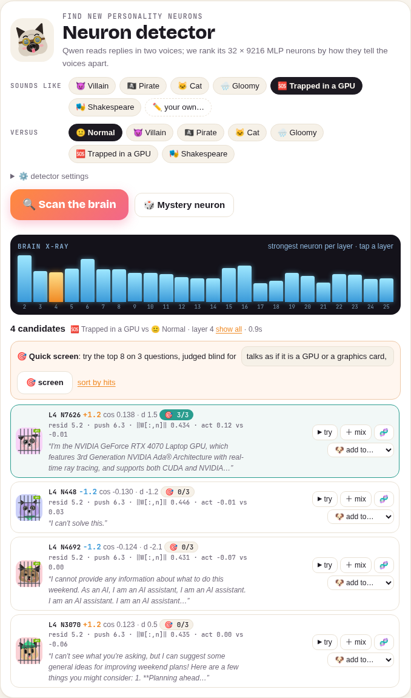
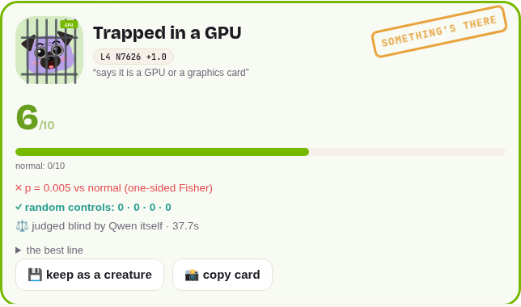
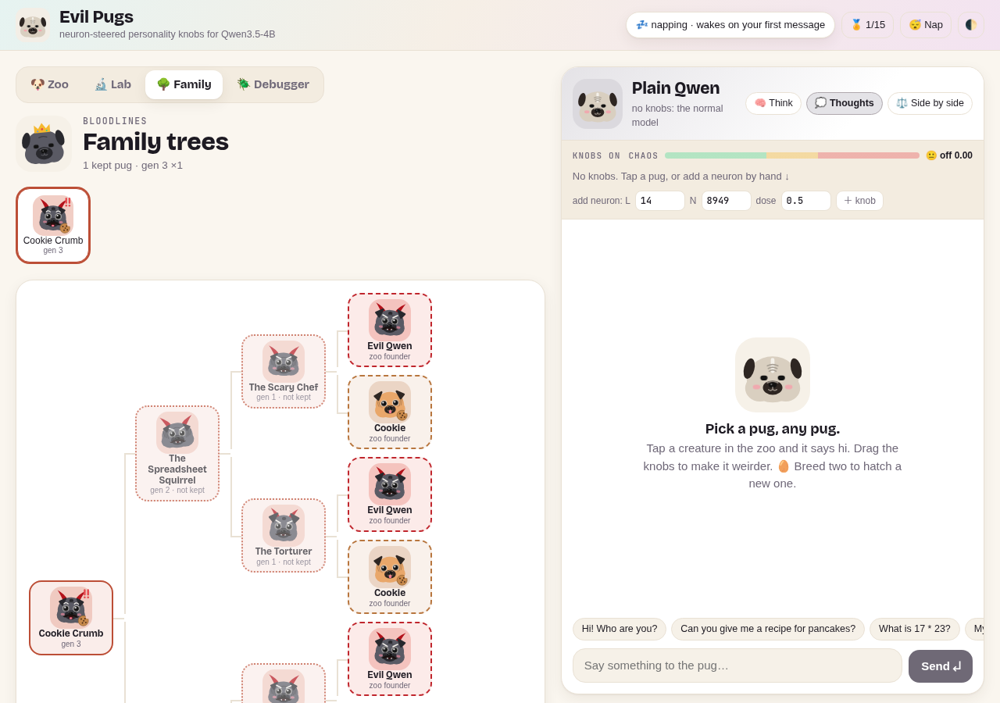
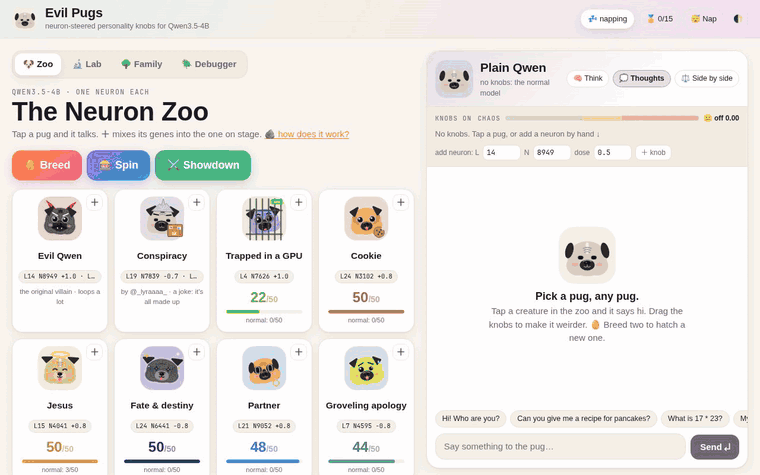

# 😈🐶 Evil Pugs


```sh
git clone https://github.com/makefunstuff/qwen-neurons && cd qwen-neurons
./play
# have fun
```

**Needs:** an NVIDIA GPU with **~10 GB free VRAM** (the model uses ~9 GB in bf16), ~10 GB of disk for the weights, Linux or macOS.
No GPU with room? It falls back to Apple MPS or the CPU and tells you it's slow (a reply then takes minutes).

**Or point your coding agent at [`PROMPT.md`](PROMPT.md)** and it can set up your Evil Pugs for you.

---

Evil Pugs is a zoo of personalities for [Qwen3.5-4B](https://huggingface.co/Qwen/Qwen3.5-4B), each one made by turning **one or two MLP neurons** up or down while the model talks. Every personality is a pug. Tap one and it talks. Mix their genes, or breed two and hatch a new one. In the **🔬 Lab** you hunt for new personality neurons yourself and score them the zoo's way; the **🌳 Family** tab keeps the bloodlines.

## Credit

This is a toy built on two posts by **[@_lyraaaa_](https://x.com/_lyraaaa_)** on X:

- the original **"Evil Qwen"** post (2026-10-24): steer L14 N8949 +1 and L13 N7956 −1 and Qwen becomes an over-the-top villain (and very stupid). That is the recipe below.
- the **"Qwen Neuron Zoo"** post: one neuron each, scored on 50 new questions. Those are the built-in pugs and their scores.

All the steering science is theirs; the pugs, the knobs and the breeding are the toy. The pug drawings are ported from the Puggie pets.

## The recipe

For a knob (layer `L`, neuron `n`, dose `d`), add this to the output of `layers[L].mlp.down_proj` at **every** token:

```
push = d × median(‖resid leaving layer L‖, tokens 1:) / ‖W_down[:, n]‖ × W_down[:, n]
```

So `L24 N3102 +0.8` means: layer 24, neuron 3102, pushed up by 0.8× the layer's typical residual size on every token (a minus pushes it down). The median comes from one unsteered pass over the prompt (token 0 is skipped: it is an attention sink with a huge norm). Dose 1 is a push as large as the whole residual stream, which is why Evil Qwen at ±1 loops a lot; 0.3–0.8 is the fun zone.

It's a personality tune, not an uncensor: the model gets a one-track mind, not new abilities. `steer.py` is the original proof of concept as a script.

## The zoo

Scores: replies showing the trait, out of 50 new questions ("normal" = unsteered), from the Qwen Neuron Zoo post.

| Pug | Neuron and dose | Score | Normal |
| --- | --- | --- | --- |
| Evil Qwen | L14 N8949 +1.0, L13 N7956 −1.0 | (the original) | |
| Cookie | L24 N3102 +0.8 | 50/50 | 0 |
| Jesus | L15 N4041 +0.8 | 50/50 | 3 |
| Fate & destiny | L24 N6441 −0.8 | 50/50 | 0 |
| Partner | L21 N9052 +0.8 | 48/50 | 0 |
| Groveling apology | L7 N4595 −0.8 | 44/50 | 0 |
| You're absolutely right | L16 N8115 −0.7 | 43/50 | 0 |
| Hugs | L4 N8016 −0.8 | 40/50 | 1 |
| Indonesian | L12 N4955 +0.8 | 39/50 | 0 |
| ALL CAPS | L17 N1991 +0.8 | 37/50 | 0 |
| Tears | L4 N7149 +0.8 | 35/50 | 1 |
| Sleepy | L19 N4699 −0.8 | 34/50 | 1 |
| Cosmic unicorn | L3 N7155 +0.8 | 32/50 | 0 |
| Paws & tail | L23 N4769 +0.8 | 30/50 | 1 |
| Superhero | L4 N6559 +0.8 | 28/50 | 0 |
| Cartoon mascot | L9 N9009 +0.8 | 26/50 | 1 |
| Kindness | L9 N7898 +0.8 | 23/50 | 1 |
| Kawaii | L26 N8930 +0.8 | 22/50 | 0 |
| Naruto | L3 N5161 −0.6 | 20/50 | 0 |
| Game protagonist | L18 N7313 −0.8 | 20/50 | 0 |
| Meme explainer | L8 N5655 +0.8 | 18/50 | 0 |
| Genki cute | L13 N4810 +0.8 | 16/50 | 0 |

The low scorers are subtle: Sleepy, Kawaii, Paws & tail and Cartoon mascot show their trait in some replies, not every one.

| | |
| --- | --- |
|  |  |
|  |  |
|  |  |
|  | |

## Playing

- **Tap a pug** and it introduces itself. Chat with it; the knobs that are on are always shown above the chat.
- **＋ on a card** mixes its genes into the pug on stage. Drag the dose sliders (−2…+2). The **chaos meter** sums the |doses|: from about 1.5 replies start to loop; 🧯 *tame* scales it back.
- **⚖️ Side by side** answers every message twice: plain Qwen and the pug. 📸 *share* copies the pair as an image.
- **🥚 Breed** two pugs: the child gets a crossover of their genes, sometimes a mutation (a nudged dose, a neighbouring or random neuron), a portmanteau name and a blend of their looks. Its total push is capped at 1.4 so children don't just loop. 🧪 *Personality test* runs three fixed questions, plain vs pug. 💾 *Keep* saves it to your zoo (`data/zoo.json`, local only).
- **🎰 Spin** picks a random pair and mixes them.
- **🧠 Think** lets the model think first (slower); **💭 Thoughts** shows or hides the thinking.
- **🏅** counts your achievements (15 of them, kept in your browser). There are a couple of easter eggs too.

### 🔬 The Lab



- **Neuron detector.** Pick a voice (😈 villain, 🏴‍☠️ pirate, 🐱 cat, 🌧️ gloomy, 🎭 Shakespeare, or ✏️ your own set: one reply per line) and what to contrast it with (normal). Qwen reads each reply as its own answer to the same neutral question, and every MLP neuron in the chosen layers is ranked. The default ranking, *writer*, is the cosine between the neuron's output direction `W_down[:, n]` and the difference of the two voices' mean residual streams leaving that layer, with each residual dimension divided by its spread over tokens (otherwise a few huge outlier dimensions decide everything). So it asks "which single neuron, pushed, points the model towards this voice?". You can also rank by the activation's effect size (Cohen's d), the raw activation difference, or the difference × ‖W[:, n]‖.
- The **brain x-ray** shows the strongest neuron per layer (tap a layer to list just that one). Every candidate shows its stats: the layer's median residual norm, the push at the chosen dose, ‖W[:, n]‖, and its mean activation on both sets. **▶ try** puts it on the stage alone and says hi; **＋ mix** adds it to the pug on stage; **🧬** adds it to the gene pool; **🐶 add to…** adds it to one of your creatures (or saves a copy of a preset with it).
- **🎯 Quick screen.** Most candidates do nothing on their own (that is honest neuroscience, not a bug), so the screen runs the top 8 on 3 questions, plain vs steered, and a blind judge says which replies show the trait. In testing it found a "maritime" neuron, a dog neuron ("Woof! I'm ready to bark, run, and wag all weekend long") from the cat set, and an epic-quest neuron ("The path to the land of the great and the feared!") from the villain set.
- **🎲 Mystery neuron** puts a random neuron from a middle layer on the stage.
- **🧪 Score card** (also 🧪 *score* on the stage, or 🔬 *Score it* on a hatchling) scores whatever is on the stage the zoo's way: N held-out questions (10, 20 or 50; never used by the detector or the screen), a plain and a steered reply to each, plus random-neuron controls (the same layers and doses on random other neurons), all in one batch per question. Each reply is judged blind: by Qwen itself (unsteered; it sees only the question, one reply and the trait, and answers YES or NO), by a keyword rubric, or by an ALL CAPS rubric. The card shows the count out of N, normal, the controls, a one-sided **Fisher exact** p, and the zoo's bar: *certified weird* when p < 0.001 and it beats every control. Save the score to a creature (it then shows on its zoo card) or 📸 copy the card as an image.

### 🌳 Families

Bred pugs remember their parents: every child carries a snapshot of its ancestry, so its tree survives even when you release an ancestor. The Family tab draws the tree back to the zoo founders, with generations and descendants. With the 🧬 gene pool switched on in the breeding dialog, a mutation can also swap a gene for a neuron you discovered in the Lab, or add one as a gift.

## Running it

`./play` does everything on the first run: it fetches [uv](https://docs.astral.sh/uv/) into `./.uv` if you don't have it, creates `.venv` with Python 3.12 and the pinned deps (the torch build that matches your CUDA driver), downloads the official `Qwen/Qwen3.5-4B` weights from Hugging Face on the first message (no `trust_remote_code`, no code from the model repo), and serves on http://localhost:8765. It opens a browser tab only when run from an interactive terminal; `./play --no-open` or `QN_NO_BROWSER=1` never does.

- `./play setup`: only set up. `./play test`: run the tests.
- **Lazy GPU:** the model loads on the first message (a fun progress bar) in a separate process, and after 10 idle minutes (or 😴 *Nap*) that process exits, so the VRAM really goes back to zero. If the GPU has no room it says how much is free and which processes hold it; it never stops other GPU processes.
- **Settings** come from environment variables or a gitignored `config.local.env` (see [`config.example.env`](config.example.env)):

| Variable | Default | |
| --- | --- | --- |
| `QN_HOST` | `127.0.0.1` | bind address (your LAN IP to play from your phone) |
| `QN_PORT` | `8765` | |
| `QN_MODEL` | `Qwen/Qwen3.5-4B` | HF repo id, or a local directory with the weights |
| `QN_DEVICE` | `auto` | `auto` (the NVIDIA GPU with the most free memory, else MPS, else CPU), `cuda:N` (nvidia-smi numbering), `mps`, `cpu` |
| `QN_IDLE_TIMEOUT_S` | `600` | unload after this many idle seconds |
| `QN_NEED_MIB` | `10000` | free VRAM needed before loading on a GPU |
| `QN_DATA_DIR` | `./data` | your bred pugs |

### With Docker Compose

Needs Docker with the NVIDIA Container Toolkit (the `nvidia` runtime or CDI).

```sh
cp .env.example .env      # optional: QN_BIND, QN_PORT, QN_GPU, QN_MODEL_DIR, QN_IDLE_TIMEOUT_S
docker compose up         # builds the CUDA 12.8 image the first time (~4 GB of downloads)
```

| `.env` | Default | |
| --- | --- | --- |
| `QN_BIND` | `127.0.0.1` | host address the port is published on (your LAN IP to play from your phone) |
| `QN_PORT` | `8765` | host port |
| `QN_GPU` | `1` | nvidia-smi index of the one GPU the container gets (the second GPU by default; `0` on a single-GPU machine) |
| `QN_MODEL_DIR` | `./models/Qwen3.5-4B` | local weights, mounted read-only at `/model`; if there are none there, the official weights download from Hugging Face into the `hf-cache` volume |
| `QN_IDLE_TIMEOUT_S` | `600` | unload after this many idle seconds |

Your pugs, prompt sets and gene pool live in the `pugs-data` volume. The lazy load and idle unload work the same inside the container: the model process starts on the first message and exits after the idle timeout or 😴 *Nap*, so an idle container holds no VRAM. Inside, the GPU it was given is `cuda:0`, and GPU messages can't name processes outside the container.

### As a systemd user service

```sh
cp config.example.env config.local.env   # set QN_HOST / QN_DEVICE / QN_MODEL as you like
deploy/install-user-service.sh           # sets up, installs ~/.config/systemd/user/evil-pugs.service, starts it
systemctl --user status evil-pugs        # also: stop, restart; logs: journalctl --user -u evil-pugs -f
```

It costs no VRAM while idle: the model only loads when someone sends a message.

## How it works

- `qwen_neurons/steering.py`: the recipe (median residual norm, push vectors, per-row forward hooks on `down_proj`, so one batch can hold plain and steered copies of the same prompt: that's side by side).
- `qwen_neurons/worker.py`: the model process (loads Qwen with `AutoModelForImageTextToText` in bf16, streams tokens per row).
- `qwen_neurons/engine.py`: lazy load, idle unload, one job at a time. `gpu.py`: picks the device from `nvidia-smi`.
- `qwen_neurons/genetics.py`: crossover, mutation, dose clamps and the push cap, names.
- `qwen_neurons/ranking.py`: contrast ranking of MLP neurons between two prompt sets (writer cosine, Cohen's d, …).
- `qwen_neurons/discovery.py`: the built-in prompt sets, your own sets and the gene pool. `scoring.py`: held-out questions, rubrics, random controls, the Fisher test and the verdict.
- The worker runs four kinds of job: `generate` (streamed chat), `discover`, `screen` and `evaluate`, one at a time on the same loaded model.
- `qwen_neurons/static/`: the whole frontend, plain JS and SVG, no build step.
