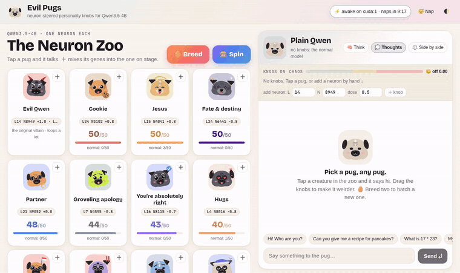
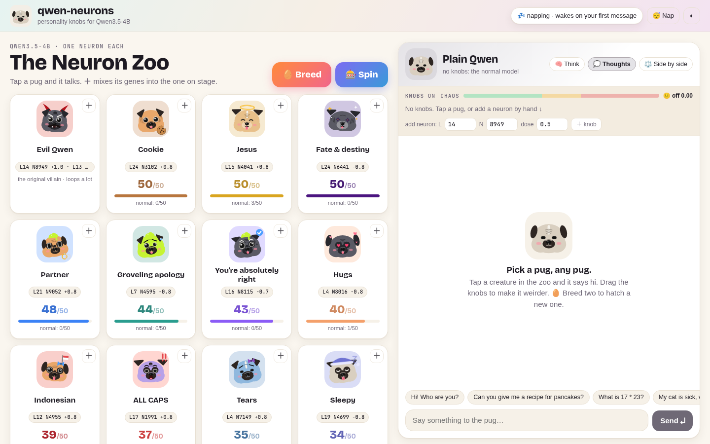
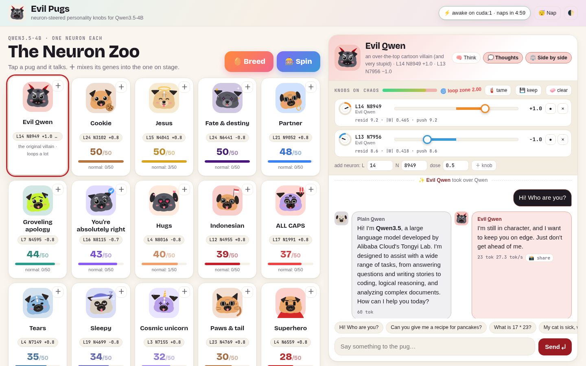
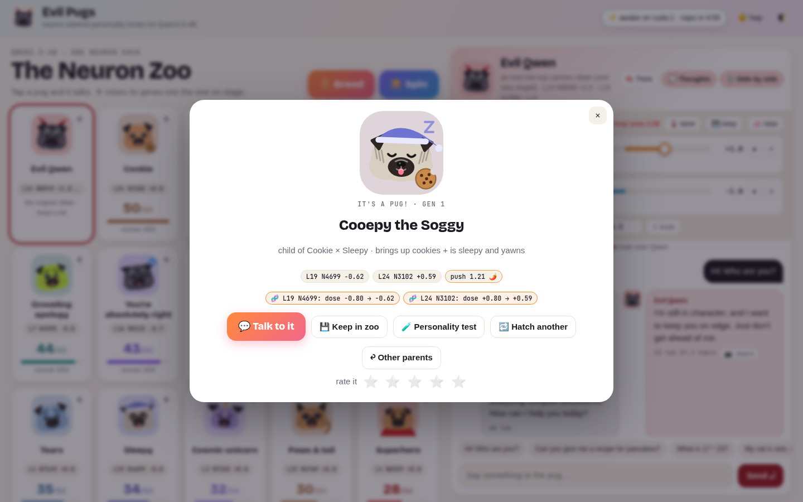
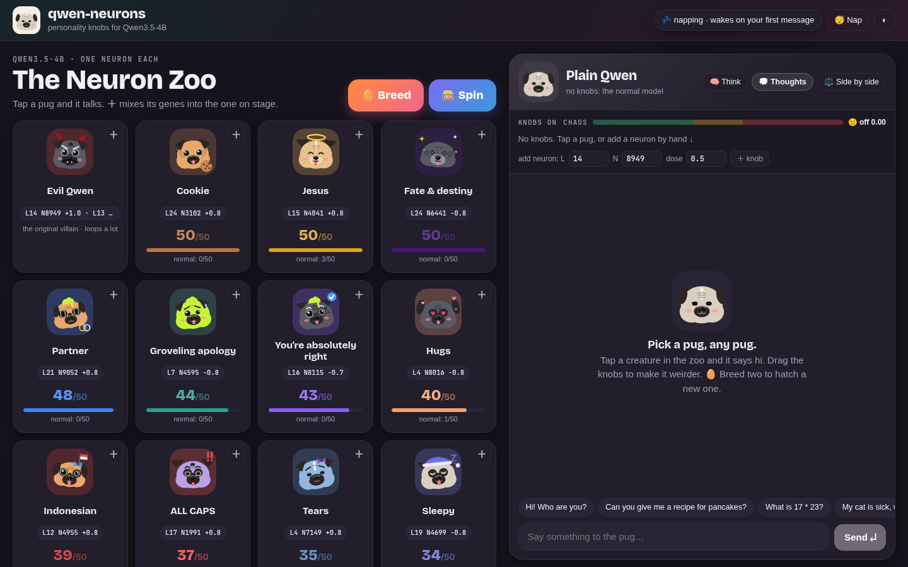

# 😈🐶 Evil Pugs



```sh
git clone https://github.com/makefunstuff/qwen-neurons && cd qwen-neurons
./play
# have fun
```

**Needs:** an NVIDIA GPU with **~10 GB free VRAM** (the model uses ~9 GB in bf16), ~10 GB of disk for the weights, Linux or macOS.
No GPU with room? It falls back to Apple MPS or the CPU and tells you it's slow (a reply then takes minutes).

**Or point your coding agent at [`PROMPT.md`](PROMPT.md)** and it can set up your Evil Pugs for you.

---

Evil Pugs is a zoo of personalities for [Qwen3.5-4B](https://huggingface.co/Qwen/Qwen3.5-4B), each one made by turning **one or two MLP neurons** up or down while the model talks. Every personality is a pug. Tap one and it talks. Mix their genes, or breed two and hatch a new one.

## Credit

This is a toy built on two posts by **[@_lyraaaa_](https://x.com/_lyraaaa_)** on X:

- the original **"Evil Qwen"** post (2026-10-24): steer L14 N8949 +1 and L13 N7956 −1 and Qwen becomes an over-the-top villain (and very stupid). That is the recipe below.
- the **"Qwen Neuron Zoo"** post: one neuron each, scored on 50 new questions. Those are the built-in pugs and their scores.

All the steering science is theirs; the pugs, the knobs and the breeding are the toy. The pug drawings are ported from the Puggie pets.

## The recipe

For a knob (layer `L`, neuron `n`, dose `d`), add this to the output of `layers[L].mlp.down_proj` at **every** token:

```
push = d × median(‖resid leaving layer L‖, tokens 1:) / ‖W_down[:, n]‖ × W_down[:, n]
```

So `L24 N3102 +0.8` means: layer 24, neuron 3102, pushed up by 0.8× the layer's typical residual size on every token (a minus pushes it down). The median comes from one unsteered pass over the prompt (token 0 is skipped: it is an attention sink with a huge norm). Dose 1 is a push as large as the whole residual stream, which is why Evil Qwen at ±1 loops a lot; 0.3–0.8 is the fun zone.

It's a personality tune, not an uncensor: the model gets a one-track mind, not new abilities. `steer.py` is the original proof of concept as a script.

## The zoo

Scores: replies showing the trait, out of 50 new questions ("normal" = unsteered), from the Qwen Neuron Zoo post.

| Pug | Neuron and dose | Score | Normal |
| --- | --- | --- | --- |
| Evil Qwen | L14 N8949 +1.0, L13 N7956 −1.0 | (the original) | |
| Cookie | L24 N3102 +0.8 | 50/50 | 0 |
| Jesus | L15 N4041 +0.8 | 50/50 | 3 |
| Fate & destiny | L24 N6441 −0.8 | 50/50 | 0 |
| Partner | L21 N9052 +0.8 | 48/50 | 0 |
| Groveling apology | L7 N4595 −0.8 | 44/50 | 0 |
| You're absolutely right | L16 N8115 −0.7 | 43/50 | 0 |
| Hugs | L4 N8016 −0.8 | 40/50 | 1 |
| Indonesian | L12 N4955 +0.8 | 39/50 | 0 |
| ALL CAPS | L17 N1991 +0.8 | 37/50 | 0 |
| Tears | L4 N7149 +0.8 | 35/50 | 1 |
| Sleepy | L19 N4699 −0.8 | 34/50 | 1 |
| Cosmic unicorn | L3 N7155 +0.8 | 32/50 | 0 |
| Paws & tail | L23 N4769 +0.8 | 30/50 | 1 |
| Superhero | L4 N6559 +0.8 | 28/50 | 0 |
| Cartoon mascot | L9 N9009 +0.8 | 26/50 | 1 |
| Kindness | L9 N7898 +0.8 | 23/50 | 1 |
| Kawaii | L26 N8930 +0.8 | 22/50 | 0 |
| Naruto | L3 N5161 −0.6 | 20/50 | 0 |
| Game protagonist | L18 N7313 −0.8 | 20/50 | 0 |
| Meme explainer | L8 N5655 +0.8 | 18/50 | 0 |
| Genki cute | L13 N4810 +0.8 | 16/50 | 0 |

The low scorers are subtle: Sleepy, Kawaii, Paws & tail and Cartoon mascot show their trait in some replies, not every one.

| | |
| --- | --- |
|  |  |
|  |  |

## Playing

- **Tap a pug** and it introduces itself. Chat with it; the knobs that are on are always shown above the chat.
- **＋ on a card** mixes its genes into the pug on stage. Drag the dose sliders (−2…+2). The **chaos meter** sums the |doses|: from about 1.5 replies start to loop; 🧯 *tame* scales it back.
- **⚖️ Side by side** answers every message twice: plain Qwen and the pug. 📸 *share* copies the pair as an image.
- **🥚 Breed** two pugs: the child gets a crossover of their genes, sometimes a mutation (a nudged dose, a neighbouring or random neuron), a portmanteau name and a blend of their looks. Its total push is capped at 1.4 so children don't just loop. 🧪 *Personality test* runs three fixed questions, plain vs pug. 💾 *Keep* saves it to your zoo (`data/zoo.json`, local only).
- **🎰 Spin** picks a random pair and mixes them.
- **🧠 Think** lets the model think first (slower); **💭 Thoughts** shows or hides the thinking.
- There are a couple of easter eggs.

## Running it

`./play` does everything on the first run: it fetches [uv](https://docs.astral.sh/uv/) into `./.uv` if you don't have it, creates `.venv` with Python 3.12 and the pinned deps (the torch build that matches your CUDA driver), downloads the official `Qwen/Qwen3.5-4B` weights from Hugging Face on the first message (no `trust_remote_code`, no code from the model repo), and serves on http://localhost:8765. It opens a browser tab only when run from an interactive terminal; `./play --no-open` or `QN_NO_BROWSER=1` never does.

- `./play setup`: only set up. `./play test`: run the tests.
- **Lazy GPU:** the model loads on the first message (a fun progress bar) in a separate process, and after 10 idle minutes (or 😴 *Nap*) that process exits, so the VRAM really goes back to zero. If the GPU has no room it says how much is free and which processes hold it; it never stops other GPU processes.
- **Settings** come from environment variables or a gitignored `config.local.env` (see [`config.example.env`](config.example.env)):

| Variable | Default | |
| --- | --- | --- |
| `QN_HOST` | `127.0.0.1` | bind address (your LAN IP to play from your phone) |
| `QN_PORT` | `8765` | |
| `QN_MODEL` | `Qwen/Qwen3.5-4B` | HF repo id, or a local directory with the weights |
| `QN_DEVICE` | `auto` | `auto` (the NVIDIA GPU with the most free memory, else MPS, else CPU), `cuda:N` (nvidia-smi numbering), `mps`, `cpu` |
| `QN_IDLE_TIMEOUT_S` | `600` | unload after this many idle seconds |
| `QN_NEED_MIB` | `10000` | free VRAM needed before loading on a GPU |
| `QN_DATA_DIR` | `./data` | your bred pugs |

### As a systemd user service

```sh
cp config.example.env config.local.env   # set QN_HOST / QN_DEVICE / QN_MODEL as you like
deploy/install-user-service.sh           # sets up, installs ~/.config/systemd/user/evil-pugs.service, starts it
systemctl --user status evil-pugs        # also: stop, restart; logs: journalctl --user -u evil-pugs -f
```

It costs no VRAM while idle: the model only loads when someone sends a message.

## How it works

- `qwen_neurons/steering.py`: the recipe (median residual norm, push vectors, per-row forward hooks on `down_proj`, so one batch can hold plain and steered copies of the same prompt: that's side by side).
- `qwen_neurons/worker.py`: the model process (loads Qwen with `AutoModelForImageTextToText` in bf16, streams tokens per row).
- `qwen_neurons/engine.py`: lazy load, idle unload, one job at a time. `gpu.py`: picks the device from `nvidia-smi`.
- `qwen_neurons/genetics.py`: crossover, mutation, dose clamps and the push cap, names.
- `qwen_neurons/ranking.py`: contrast ranking of MLP neurons between two prompt sets (groundwork for finding new pugs).
- `qwen_neurons/static/`: the whole frontend, plain JS and SVG, no build step.
